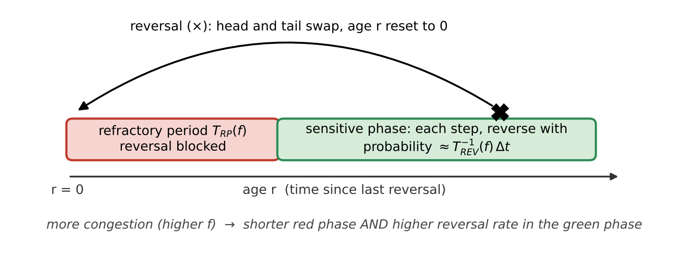
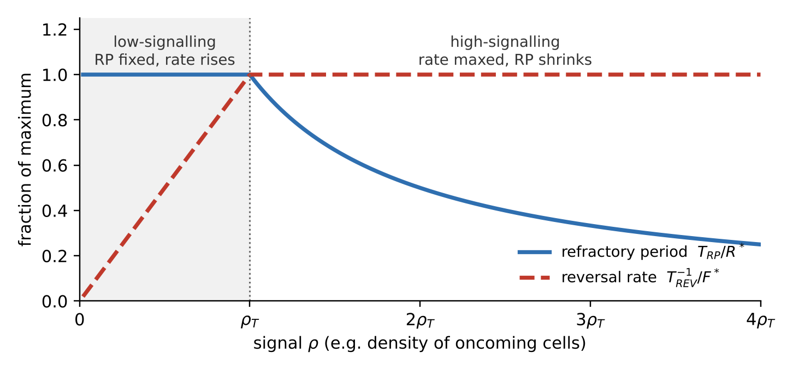
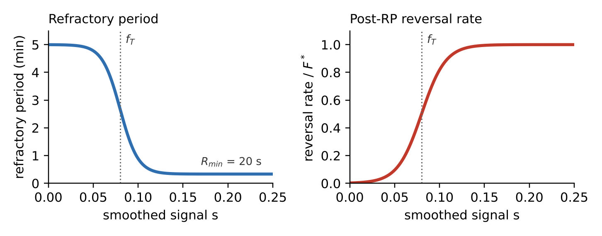

# Rippling & Swarming in *Myxococcus xanthus*

*Model foundations for building the simulation — working draft*

Source: Saulnier et al., *Nature Physics* (2026), doi:10.1038/s41567-026-03416-y · Motility Sim project · Draft 1, 9 October 2026

## 0. Scope and how to read this

This draft distils the authors' own model from the paper's Results — from the opening single-cell measurements through “Pattern segregation and persistence” — together with the Methods entries that define that model and its measurements. It leaves out the Introduction's survey of earlier models, the Discussion, and comparisons with other groups. Each idea is put in plain terms first, then stated exactly.

Some details sit in Supplementary sections the PDF doesn't include (notably the explicit 2D reversal curves, Suppl. Fig. 26). For those I used the authors' released code, which is part of this paper's own work. Non-obvious statements carry a source tag:

| **Tag**          | **Meaning**                                                                                                                                                     |
|------------------|-----------------------------------------------------------------------------------------------------------------------------------------------------------------|
| **\[Paper\]**    | Stated in the PDF: main text, figure legends or Methods.                                                                                                        |
| **\[Code\]**     | From the authors' released code (github.com/MignotLab/SpatialPatternsCollectives), used only where the PDF defers to Supplementary material it doesn't contain. |
| **\[Derived\]**  | My own algebra from the paper's equations, shown step by step so you can check it.                                                                              |
| **\[Decision\]** | Left open by the paper; we have to choose.                                                                                                                      |

## 1. The core idea in one paragraph

The paper argues that rippling and swarming are not two behaviours with two rule books. Every cell runs one reversal rule: when its movement is obstructed (it is “frustrated”), it becomes more likely to reverse, and — the key ingredient — the lock-out period after each reversal (the refractory period, RP) gets shorter. The only thing that differs between the two fields is how the ground tells cells which way to point. On digested prey, a prey-derived matrix makes every cell line up along one shared axis; outside, cells line up only with slime (EPS) trails that other cells have left. One axis plus congestion-driven reversals synchronises into travelling waves (rippling); branching trails plus the same reversals give a network of streams (swarming).

> *Picture the same crowd with the same habit — “if you're blocked, turn round” — in a long corridor and in a park with footpaths. In the corridor, the turnarounds pile up into pulses that bounce back and forth. In the park, they just clear local jams.*

## 2. Rippling vs swarming in the authors' model

### 2.1 What both fields share

- **Same reversal engine.** A reversal swaps a cell's head and tail (its motility machinery relocates to the other pole), so the cell instantly runs the opposite way. **\[Paper\]**

- **Same trigger.** In both fields, reversals respond to frustration — how far a cell's actual motion falls short of its intended motion — not to cell density. **\[Paper\]**

- **Same timing rule.** After each reversal there is an RP, then a reversal rate; more frustration shortens the RP and raises the rate. **\[Paper\]**

- **Same body and physics.** Cell size, speed, springs, repulsion and every parameter are identical in the rippling and swarming simulations. **\[Paper\]**

- **Alignment doesn't need reversals.** Reversal-defective *frzE* cells still line up on the prey area and still move in coherent flocks outside it, so alignment comes from the extracellular matrix (ECM) and cell contacts, not from reversing. **\[Paper\]**

### 2.2 What differs

| **Feature**                                           | **Rippling**                                                                   | **Swarming**                                                       |
|-------------------------------------------------------|--------------------------------------------------------------------------------|--------------------------------------------------------------------|
| **Where**                                             | Inside the former prey colony, once the prey is fully digested                 | Prey-free ground around it                                         |
| **Model alignment rule**                              | Nematic pull towards one prescribed axis; no EPS laid or followed **\[Code\]** | Turn towards self-deposited EPS trails inside a forward semicircle |
| **Alignment vs distance (Fig. 1c)**                   | Stays high: ≈0.85 at 5 µm, ≈0.6 at 85 µm (read off the plot)                   | ≈0.55 at 5 µm, down to ≈0.05 by about 25 µm                        |
| **TBR distribution (experiment)**                     | Two peaks (bimodal); mean 3.21 min, n = 5,283                                  | One peak (unimodal); mean 3.73 min, n = 5,904                      |
| **Frustration distribution**                          | Mean 0.48; sharp peak, negatively skewed                                       | Mean 0.68; broad, low skew                                         |
| **Reversals in each cell's top frustration quartile** | 50.5 ± 2.5%                                                                    | 43.6 ± 2.1%                                                        |
| **Correlation with density signals**                  | Weak, with directional density only                                            | None (local density even slightly negative)                        |
| **2D simulation (500 min)**                           | N = 9,000 cells; bimodal TBR, mean 5.02 min                                    | N = 3,330 cells; unimodal TBR, mean 3.27 min                       |
| **Residence per visit (split-box simulation)**        | Mean 121 min                                                                   | Mean 67 min                                                        |
| **Visible pattern**                                   | Counter-propagating waves                                                      | Slowly evolving network of streams                                 |
| **Without reversals (*frzE*)**                        | No ripples; cells cross straight through and aren't trapped                    | Flocks that never settle into streams                              |

### 2.3 Why the signatures differ — cause to effect

1.  **Rippling.** The prey matrix sets one axis, so cells form two opposing streams on the same line.

2.  Jams happen mainly where one wave meets an oncoming one, so frustration is usually low and spikes at wavefronts (the sharp distribution, mean 0.48).

3.  At a collision the spike shortens the RP towards 20 s, so a trapped cell can reverse several times in quick succession: the short-interval peak of the bimodal TBR.

4.  A cell carried inside a wave reverses again only when it meets the next oncoming wave, so its interval tracks wave spacing: the second, longer peak.

<!-- -->

1.  **Swarming.** Trails are narrow and branch in many directions, so cells squeeze past each other continually.

2.  Congestion is chronic and scattered, giving a higher, broader frustration distribution (mean 0.68).

3.  Reversals relieve these jams one at a time without synchronising, so the intervals form a single peak.

The density correlation seen only in rippling is a side-effect, not a second trigger. In simulations driven by frustration alone, directional density (oncoming neighbours) still correlates with reversals in rippling — the 1D geometry puts oncoming cells exactly where jams form — but not in swarming, matching the experiments. When directional density is made the trigger instead, it correlates with reversals in both fields, which isn't observed, and only the frustration-driven version reproduces swarming's single-peaked TBR. **\[Paper\]**

## 3. Model mechanics and parameters

### 3.1 The biological switch being modelled

The model encodes how the Frz pathway controls reversals. Activating the receptor FrzCD makes the kinase FrzE phosphorylate two regulators: FrzX~P acts at the lagging pole by blocking MglB, and FrzZ~P acts at the leading pole by freeing MglA-GTP. The RP is set by how quickly RomR relocates to the lagging pole. This gives two operating regimes, which the model turns into rules: **\[Paper\]**

| **Regime**      | **What the cell does**                                                             | **Model rule**                                                      |
|-----------------|------------------------------------------------------------------------------------|---------------------------------------------------------------------|
| **Low signal**  | RP fixed by RomR relocation; a reversal fires once the RP is over and FrzX~P rises | RP constant at its maximum R\*; reversal rate rises with the signal |
| **High signal** | FrzX~P outcompetes MglB and FrzZ~P releases MglA-GTP, shortening the RP            | Reversal rate at its maximum F\*; RP shrinks as the signal rises    |

The molecular picture comes from the authors' earlier single-cell work (their ref. 24). What's new here is asking what each regime does to collective patterns.

### 3.2 The reversal clock (shared by both models)

Each cell carries an age r: the time since its last reversal. While r is below the RP, reversal is impossible; past it, the cell reverses at random at a given rate. A reversal resets r to zero. Congestion acts on both phases at once.

*Figure 1. The reversal cycle of one cell (after Figs. 2a and 4b).* **\[Paper\]**

### 3.3 The 1D continuum model (age-structured PDE)

Purpose: find the conditions under which waves can appear at all. The model treats a cross-section of a rippling field as a line and, instead of individual cells, tracks densities: u+(t, x, r) and u−(t, x, r) are the amounts of right- and left-moving cells at time t, position x and age r. Cells move at constant speed v. **\[Paper\]**

#### Equations [Paper]

∂tu± ± v ∂xu± + ∂ru± = − TREV−1(ρ∓) · H(r − TRP(ρ∓)) · u±

u±(t, x, r = 0) = ∫0∞ TREV−1(ρ±) · H(r − TRP(ρ±)) · u∓(t, x, r) dr

ρ±(t, x) = ∫0∞ u±(t, x, r) dr

Reading it term by term:

- ∂tu is the change over time at a fixed place and age.

- ± v ∂xu is transport: right-movers drift right and left-movers drift left, at speed v.

- ∂ru is ageing: every cell's clock ticks at rate 1.

- The right-hand side removes cells that reverse. H is the Heaviside step (0 before the RP, 1 after), so only cells older than TRP can leave, at rate TREV−1.

- The r = 0 line puts reversed cells back into the opposite family with their clock reset, so total cell number is conserved.

- A right-mover's signal is ρ−, the density of cells coming towards it (directional density). The authors also tested local density, ρ+ + ρ−.

#### The two regimes as functions [Paper]

Low (ρ ≤ ρT): TRP(ρ) = R\*, TREV−1(ρ) = (F\*/ρT) · ρ

High (ρ ≥ ρT): TREV−1(ρ) = F\*, TRP(ρ) = R\* · ρT / ρ

*Figure 2. The two regimes, normalised (after Fig. 2b). At ρT the curves meet: RP = R\* and rate = F\*.*

Both signal types produce counter-propagating waves in simulation, provided the signal locally enters the high-signalling regime where waves collide (Fig. 2c). **\[Paper\]**

#### Stability analysis in plain terms

Start from a perfectly even population, add tiny wave-shaped wiggles of every wavelength, and ask whether each grows or dies away. A wiggle of spatial frequency ξ has growth rate Λ(ξ); if the largest real part, max Re Λ, is positive, some wiggle grows into a pattern. After rescaling, Λ depends on only two numbers: **\[Paper\]**

S = TRP(ρ̄) / TREV(ρ̄) C = − ∂ log(TRP + TREV) / ∂ log ρ

- **S** compares the locked phase with the waiting phase at the steady density ρ̄. A large S means the cycle is mostly lock-out, so cells behave like pacemakers; a small S means reversal timing is close to random.

- **C** is the coupling: by what percentage the full cycle shortens when the signal rises by 1%.

#### Deriving C from S [Derived]

The paper notes that C can be written in terms of S once TRP and TREV are chosen. With its chosen functions, the algebra is short:

1.  Call the full cycle time T = TRP + TREV. A log-derivative is a relative change: ∂ log T/∂ log ρ = (ρ/T)(dT/dρ). So C = −(ρ/T)(dT/dρ).

2.  Low regime: TRP = R\* is constant and TREV = ρT/(F\*ρ), so dT/dρ = −TREV/ρ. Substituting gives C = TREV/(TRP + TREV); dividing top and bottom by TREV gives **C = 1/(1 + S)**.

3.  High regime: TREV = 1/F\* is constant and TRP = R\*ρT/ρ, so dT/dρ = −TRP/ρ. The same steps give C = TRP/(TRP + TREV) = **S/(1 + S)**.

What this means: in the low regime, a relatively longer RP (larger S) weakens the coupling, so the two ingredients pull against each other. In the high regime they reinforce each other, and C approaches 1 as S grows. That's the algebraic reason the high regime can make waves once S is large.

#### Result [Paper]

- High-signalling regime: max Re Λ turns positive above a threshold S, so waves emerge (Fig. 2d).

- Low-signalling regime: max Re Λ stays near zero, within numerical error. Directional density allows only very slow growth; local density allows none.

- Directional density works over a wider range of S and makes waves faster than local density. The choice of signal changes the result only quantitatively.

- More strongly nonlinear signal functions raise C and can allow patterns even in the low regime, but they narrow the range of signal levels that work. The low-to-high switch widens that range.

- An oscillator-type (phase-structured) model, extended here with RP modulation, gives the same conclusion: modulating the RP makes patterns emerge faster and more robustly.

#### 1D simulation settings [Code]

The PDF gives no numbers for the 1D model. The authors' code uses:

| **Quantity**                  | **Value**                                              |
|-------------------------------|--------------------------------------------------------|
| **Domain length (grid)**      | 100 µm (0.1 µm)                                        |
| **Age axis (grid)**           | 0–15 min (0.1 min)                                     |
| **Speed v**                   | 3 µm min−1                                  |
| **R\* / F\* / ρT** | 5 min / 10 min−1 / 0.5                      |
| **Initial total density**     | 0.45, plus small random fluctuations (amplitude 0.001) |
| **Run length; time step**     | 100 min; Δt = 0.25 · min(Δx, Δr) / max(v, 1)           |

### 3.4 The reversal signal: frustration

Frustration measures how far a cell's real motion falls short of its intended motion. The target velocity vt points along the cell body at a constant 4 µm/min; the real velocity vr comes from the head's displacement between consecutive frames. **\[Paper\]**

f = 1 − (vt · vr) / max(‖vt‖2, ‖vr‖2)

f runs from 0 (moving exactly as intended) to 2 (pushed straight backwards). Slowing down, being deflected and being pushed faster are all penalised, as these worked cases show: **\[Derived\]**

| **Situation**                             | **f** |
|-------------------------------------------|-------|
| Moving as intended                        | 0     |
| Same direction, half speed                | 0.5   |
| Same direction, pushed to twice the speed | 0.5   |
| Deflected 60° at full speed               | 0.5   |
| Stopped dead                              | 1     |
| Deflected 90° at full speed               | 1     |
| Pushed straight backwards at full speed   | 2     |

#### Smoothing over time

- Experiments: f is averaged over nine frames (one frame every 2 s, so about 18 s). **\[Paper\]**

- 2D model: a memory of d = 20 s with a kernel exponent β, printed as “2 min”, which gives recent values more weight. **\[Paper\]**

The code implements this as a weighted average over the last 20 s, rescaled to 0–1: **\[Code\]**

s(t) = Σk wk f(t − kΔt) / (2 Σk wk), wk = e−β(k+1)Δt, k = 0 … 65

> **Why this matters.** The factor 2 rescales f from 0–2 to 0–1, so the threshold fT = 0.08 applies to s — a raw average frustration of about 0.16. And β acts as a rate (2 min−1): over 20 s the oldest sample still carries about half the weight of the newest, so this is close to a plain moving average. **\[Code\]**

#### How reversals were linked to frustration [Paper]

Because cells differ, each trajectory is compared with itself. Its frustration values are split into its own quartiles, and each reversal is assigned to the quartile its frustration fell in. With no link, every quartile would hold 25% of reversals.

| **Own-frustration quartile**         | **\< 25%**  | **25–50%**  | **50–75%**  | **\> 75%**  |
|--------------------------------------|-------------|-------------|-------------|-------------|
| **Rippling (n = 222,769 reversals)** | 9.2 ± 1.9%  | 15.5 ± 1.3% | 24.7 ± 0.8% | 50.5 ± 2.5% |
| **Swarming (n = 70,406)**            | 11.4 ± 1.3% | 18.1 ± 0.8% | 26.9 ± 1.2% | 43.6 ± 2.1% |

The enrichment survives when only changes in direction are used (not speed), so it isn't just the slowdown before a reversal. The rival signals were local density — the number of cells in contact (each skeleton sampled at 11 points; contact if closer than 0.84 µm) — and directional density, the contacting cells whose orientation vectors point against the focal cell's (negative dot product). **\[Paper\]**

### 3.5 The 2D agent-based model

Three hypotheses define it **\[Paper\]**: (H1) frustration triggers reversals; (H2) the RP and the post-RP rate both depend on frustration, with more frustration giving a shorter RP and a higher rate; (H3) cells align with the ECM, whose structure differs by field. H3 is the only difference between rippling and swarming runs.

#### Cell body and motion

- Each cell is a chain of ND = 10 discs, 0.5 µm apart (5 µm long), each 0.7 µm in diameter. **\[Paper\]**

- Springs (ks = 50 min−1) hold the spacing; a distance-dependent repulsion between disc centres (kr = 450 µm−1 min−1) prevents overlap. **\[Paper\]**

- Traction acts on the head disc along the body axis and the springs drag the rest along; cell speed is 4 µm/min. **\[Paper\]**

- In the code the head moves v·ND·Δt per step. Spring corrections push neighbouring discs equally and oppositely, so the chain's centre of mass advances exactly v·Δt per step: the cell as a whole moves at 4 µm/min. Springs are relaxed 50 times (5·ND) per step. **\[Code\]**

- Repulsion in the code, for two discs closer than D: magnitude (D − r)2 / max(r − 0.9D, 2/kr), along the line between centres. The push rises steeply with overlap, and kr only caps it at deep overlap. **\[Code\]**

- The box has periodic boundaries (a cell leaving one side re-enters the opposite side) and cell number is fixed, with no growth or death. **\[Paper\]** Time step Δt = 0.005 min (0.3 s). **\[Code\]**

#### Reversal rule (H1 + H2)

The PDF calls the 2D curves smooth versions of Fig. 2b and puts the formulas in Suppl. Fig. 26. The code uses logistic (S-shaped) curves: **\[Code\]**

TRP(s) = R\* − (R\* − Rmin) / (1 + exp\[−αR(s − fT)\])

TREV−1(s) = F\* / (1 + exp\[−αF(s − fT)\])

*Figure 3. Refractory period and reversal rate against the smoothed signal s, using the paper's parameters. Around fT the cell switches from “locked for 5 min, rarely reverses” to “locked for 20 s, reverses at the maximum rate”.*

For each cell, every time step:

1.  Advance the age: r ← r + Δt.

2.  Update the smoothed signal s from this step's frustration and clamp it to \[0, 1\].

3.  Compute TRP(s) and TREV−1(s).

4.  If r ≥ TRP(s), reverse with a small probability p this step; otherwise don't.

5.  On reversal, reverse the disc order (the head becomes the tail) and reset r to 0.

> **Implementation note.** The paper's model implies p ≈ TREV−1Δt. The code instead uses p = (1 − exp\[−TREV−1(s)\])·Δt, which caps the effective post-RP rate near 1 min−1: 0.95 min−1 with the code default F\* = 3, and 1.00 min−1 with the paper's F\* = 30. Under this formula the two printed values of F\* behave almost identically. Initial ages are drawn at random between 0 and R\*. **\[Code\]**

#### Alignment rule (H3)

**Rippling: one global axis.** Cells in the prey-matrix zone are turned towards a prescribed direction θ0 (horizontal in the paper) **\[Paper\]** by a nematic torque **\[Code\]**:

Δθ = γ′ · sin 2(θ0 − θ) · Δt

The factor 2 makes θ0 and θ0 + π equally attractive, so cells line up along the axis with half facing each way — the two opposing streams that waves need. The turn rotates the head disc about the second disc. Cells in this zone neither lay nor follow EPS. **\[Code\]**

**Swarming: EPS trails.** The concept is from the paper **\[Paper\]**; the mechanics below are from the code **\[Code\]**:

1.  Deposit: every cell adds a·v·Δt of EPS (a = 2 min−1) to the grid square under its rear disc. Grid squares are 0.3 µm, and EPS effectively never decays.

2.  Sense: look into a semicircle (2α = π) of radius H ≈ 5 µm ahead of the head, cut it into 5 equal wedges, and sum the EPS in each.

3.  Threshold: if no grid square in the semicircle exceeds cmin = 0.1, keep the current heading.

4.  Choose: among wedges holding at least 80% of the best wedge's EPS, pick the one closest to the current heading.

5.  Turn towards it: Δθ = γ · sin 2(θEPS − θ) · Δt, with γ = 11.

Units: the paper prints γ and γ′ as µm min−1, but they enter as a turning rate (radians per minute), so treat them as min−1.

#### Parameter table [Paper]

Grouped into the paper's own four categories, plus the run settings that only appear in the code.

| **Symbol**                                       | **Meaning**                   | **Value**                            | **Note**                                              |
|--------------------------------------------------|-------------------------------|--------------------------------------|-------------------------------------------------------|
| **1. From the literature**                       |                               |                                      |                                                       |
| **R\***                                          | Maximum refractory period     | 5 min                                |                                                       |
| **ε**                                            | Spacing between discs         | 0.5 µm                               |                                                       |
| **ND**                                | Discs per cell                | 10                                   | Gives a 5 µm cell                                     |
| **H**                                            | Trail-sensing reach           | ≈ 5 µm                               | About one cell length                                 |
| **cmin**                              | Minimum detectable EPS        | 0.1                                  | Code: equals EPSmax/100                    |
| **2. Measured in this study**                    |                               |                                      |                                                       |
| **D**                                            | Disc diameter (cell width)    | 0.7 µm                               |                                                       |
| **v**                                            | Cell speed                    | 4 µm min−1                |                                                       |
| **Rmin**                              | Minimum refractory period     | 20 s                                 | From the TBR distribution                             |
| **3. Ad hoc (chosen to behave physically)**      |                               |                                      |                                                       |
| **ks**                                | Spring constant               | 50 min−1                  |                                                       |
| **kr**                                | Repulsion coefficient         | 450 µm−1 min−1 |                                                       |
| **2α**                                           | Angle of view (pilus reach)   | π                                    | Semicircle ahead of the head                          |
| **a**                                            | EPS deposition rate           | 2 min−1                   |                                                       |
| **EPSmax**                            | Maximum EPS grid value        | 10                                   | Code: sets the detection floor                        |
| **γ′**                                           | Rippling alignment strength   | 11                                   | Printed µm min−1; acts as min−1 |
| **γ**                                            | EPS alignment strength        | 11                                   | Printed µm min−1; acts as min−1 |
| **F\***                                          | Maximum reversal rate         | 30 min−1                  | Code default 3; see implementation note               |
| **d**                                            | Frustration memory            | 20 s                                 |                                                       |
| **β**                                            | Memory kernel exponent        | 2                                    | Printed “min”; code uses it as min−1       |
| **4. Fitted to the TBR distributions**           |                               |                                      |                                                       |
| **fT**                                | Frustration threshold         | 0.08                                 | Applies to the rescaled signal s                      |
| **αF**                                | Steepness of the rate curve   | 75                                   |                                                       |
| **αR**                                | Steepness of the RP curve     | 100                                  |                                                       |
| **Run settings found only in the code \[Code\]** |                               |                                      |                                                       |
| **Δt**                                           | Time step                     | 0.005 min                            | 0.3 s                                                 |
| **—**                                            | EPS grid spacing              | 0.3 µm                               |                                                       |
| **—**                                            | Wedges in the view semicircle | 5                                    |                                                       |
| **—**                                            | Neighbour search radius       | 1.4 µm                               | Twice the cell width                                  |
| **T**                                            | Run length                    | 500 min                              | Also stated in the paper                              |

### 3.6 What to measure (validation metrics) [Paper]

- **TBR:** time between a cell's consecutive reversals. Experiments kept only tracks longer than 1,000 frames (33 min).

- **Reversal detection** in videos: sharp turns in smoothed trajectories, checked against the pole-switching marker SgmX-YFP. In a simulation, reversals are known exactly.

- **Nematic order O(r):** the average of \[2cos2(θi − θj) − 1\] over neighbours in a thin ring at distance r (5–100 µm). It is 1 when cells are parallel or antiparallel and 0 when orientations are random.

O(r) = ⟨ (1/Ni(r)) Σj \[2 cos2(θi − θj) − 1\] ⟩i

- **Frustration quartile fractions,** as in section 3.4.

- **Residence time per visit:** the length of each uninterrupted stay in one domain, counted from t = 100 min (patterns settled) to 500 min.

- **Occupancy ratio** Nrippling/Ntotal over time.

- **Kymograph:** positions projected onto the cells' mean direction, with frames stacked in time.

Targets to reproduce:

| **Signature**                                           | **Experiment**                                       | **2D simulation**                                               |
|---------------------------------------------------------|------------------------------------------------------|-----------------------------------------------------------------|
| **Rippling TBR**                                        | Bimodal; mean 3.21 min (n = 5,283)                   | Bimodal; mean 5.02 min (9,000 cells; n = 88,679)                |
| **Swarming TBR**                                        | Unimodal; mean 3.73 min (n = 5,904)                  | Unimodal; mean 3.27 min (3,330 cells; n = 50,927)               |
| **Rippling: reversals in top own-frustration quartile** | 50.5 ± 2.5%                                          | Matches (Fig. 5d), without extra fitting                        |
| **Swarming: the same**                                  | 43.6 ± 2.1%                                          | Matches (Fig. 5h), without extra fitting                        |
| **Nematic order**                                       | Long-range in rippling; short-range in swarming      | Swarming curve matches (Fig. 5f); rippling alignment is imposed |
| **Frustration distributions**                           | Rippling mean 0.48, sharp; swarming mean 0.68, broad | Same contrast (Suppl. Fig. 34)                                  |

The authors aimed to match each distribution's shape, not its exact mean: the simulated mean TBR shifts with parameters (more cells lowers it in rippling; weaker EPS raises it in swarming). Noise-free simulations show a stronger frustration–reversal link than experiments; adding realistic tracking noise brings it down to the measured level. **\[Paper\]**

### 3.7 Pattern segregation and persistence

**Setup** **\[Paper\]**: one box split in two, with the rippling rule on the left half and the swarming rule on the right. Cells start at random within each half, denser on the rippling side, since *M. xanthus* grows preferentially on prey. In the code the box is 390 µm wide; the rippling half always holds 18,000 cells, while the swarming half holds 36,000, 18,000, 9,000, 6,000 or 4,500 to give initial ratios from 1:2 to 4:1. **\[Code\]**

**Findings** **\[Paper\]**:

- Both patterns form and stay separated by a sharp boundary for the full 500 min, even though individual cells cross it.

- From every initial ratio (1:2, 1:1, 2:1, 3:1, 4:1), the system settles on a stable split favouring the rippling side, so the density difference is self-generated rather than inherited.

- The mechanism is trapping. In 3:1 runs (5 simulations), the mean residence per visit is 121 min in rippling against 67 min in swarming, because wave collisions keep interrupting forward motion.

- With reversing and non-reversing cells mixed 10:1, both types form cohesive swarms in the swarming half. In the rippling half, reversers make waves while non-reversers form streams.

- Non-reversers have one fixed residence time (domain length ÷ speed) and end up spread almost evenly between the halves. Starting from 70% of each type on the rippling side, reversers stay confined there while non-reversers leave.

- On prey, mixed wild-type and *frzE* cells show the same depletion of *frzE* from the rippling field (22 sub-areas sampled), marked after 72 h.

- A swarming simulation of *frzE* alone gives flocks that never settle into streams, as the mutant does.

Conclusion: reversals plus local ECM differences are enough to create stable, insulated domains, and to sort out cells that don't follow the rules.

## 4. Simulation prerequisites

### 4.1 Per-cell state

| **Variable**                    | **Form**            | **Meaning and update**                                                       |
|---------------------------------|---------------------|------------------------------------------------------------------------------|
| **Disc positions**              | 10 × (x, y)         | The body; disc 0 is the head                                                 |
| **Heading θ**                   | Derived             | Direction from disc 1 to disc 0                                              |
| **Age r**                       | Float (min)         | Time since last reversal; +Δt each step; reset to 0 on reversal              |
| **Frustration memory**          | 66 recent values    | The last 20 s of f, for the weighted average                                 |
| **Smoothed signal s**           | Float in \[0, 1\]   | Drives TRP and the reversal rate                                  |
| **Head velocity vr** | (x, y)              | Head displacement over the step ÷ Δt                                         |
| **Zone**                        | Rippling / swarming | From head position (later: from a prey-matrix field)                         |
| **Can reverse?**                | True / false        | False for *frzE*-like cells                                                  |
| **Bookkeeping**                 | Floats              | Time of last reversal (for TBR); start of current visit (for residence time) |

### 4.2 Global state

- Box size and periodic wrapping.

- EPS grid (0.3 µm squares), updated every step by cells in the swarming zone.

- Zone map: where the rippling axis is imposed, and the axis θ0 there.

- A neighbour search structure over all discs (for example a KD-tree) with a 1.4 µm cutoff.

- Simulation clock and a seeded random-number generator, for reproducible runs.

### 4.3 Order of operations in one time step [Code]

1.  Wrap all discs back into the box.

2.  Update each cell's zone from its head position.

3.  Record head positions (start of step).

4.  Find neighbouring discs within 1.4 µm.

5.  Traction: move each head disc forward along its heading.

6.  Repulsion between overlapping discs, skipping a disc's direct neighbours in its own chain.

7.  Spring relaxation along each chain (50 passes).

8.  Alignment: the rippling torque, or EPS deposit, sense and steer.

9.  Record head positions (end of step) and compute vr.

10. Compute f, then update the memory and s.

11. Reversal decision: flip reversing cells and reset their age.

12. Log metrics.

The order matters: frustration must see the whole step's realised motion — traction, pushes and turning together — or it underestimates congestion.

### 4.4 Initial conditions and run settings

Cell numbers are from the paper; box sizes and start rules are from the code. **\[Code\]**

| **Run**                            | **Cells**                        | **Box**      | **Start**                                               | **Length** |
|------------------------------------|----------------------------------|--------------|---------------------------------------------------------|------------|
| **Rippling only (Fig. 5a)**        | 9,000                            | 195 × 195 µm | Random positions; heading along the axis, half each way | 500 min    |
| **Swarming only (Fig. 5e)**        | 3,330                            | 195 × 195 µm | Random positions and headings                           | 500 min    |
| **Coexistence (Fig. 6)**           | 22,500–54,000                    | 390 × 390 µm | Random within each half; 18,000 on the rippling side    | 500 min    |
| **Quick test (authors' examples)** | 1,000 rippling; 300–370 swarming | 65 × 65 µm   | As above                                                | Short      |

Implied densities: about 0.24 cells per µm² on the rippling side and 0.09 on the swarming side. At Δt = 0.005 min, 500 min is 100,000 steps.

### 4.5 What “working” means

1.  Rippling TBR has two peaks; swarming TBR has one.

2.  Nematic order stays high with distance in rippling and collapses within about 20 µm in swarming.

3.  About half of rippling reversals, and about 44% of swarming reversals, fall in each cell's top frustration quartile.

4.  Swarming frustration is higher and broader than rippling frustration.

5.  In a split box, the boundary stays sharp, the density ratio settles in favour of rippling, and residence per visit is about twice as long there.

6.  Non-reversing cells aren't trapped in the rippling half.

## 5. What the paper leaves to us

- **No prey.** Rippling is a fixed zone: there's no *E. coli* growth, killing, digestion or matrix deposition. Turning digested prey into a rippling zone is our design. **\[Decision\]**

- **No origin for the rippling axis.** The authors impose a horizontal axis and call its mechanism unknown, so we must decide how each prey patch sets θ0. **\[Decision\]**

- **No growth or death.** Cell number is conserved; any *M. xanthus* division is our addition. **\[Decision\]**

- **2D only.** Any 3D would be rendering on top of 2D physics. **\[Decision\]**

- **Printed-versus-coded mismatches:** F\* (30 vs 3) and the per-step reversal probability; the unit of β; and whether fT applies to raw f or the rescaled s (the code uses s). **\[Decision\]**

## 6. Next: custom additions and execution plan

These are the items to settle together before writing code. My suggestions are only a starting point.

| **Decision**                | **Options**                                                                                 | **Suggestion**                                                         |
|-----------------------------|---------------------------------------------------------------------------------------------|------------------------------------------------------------------------|
| **Cell body**               | 10-disc chain (faithful, slower) · simpler rod or disc (fast, approximate)                  | Chain, so validation matches the paper                                 |
| **Reversal probability**    | Code form (1 − e−R)·Δt · literal form ≈ R·Δt                                     | Code form first, to reproduce their figures; then test the literal one |
| **Scale**                   | Paper sizes (9,000 cells, 100,000 steps) · authors' quick test (1,000 cells, 65 µm box)     | Quick-test size first, then scale up                                   |
| **Prey representation**     | Biomass field on a grid · individual *E. coli* agents                                       | Field: simpler, and enough to drive a matrix zone                      |
| **Rippling axis per patch** | One global axis · per-patch axis (e.g. the patch's long axis) · from local matrix structure | Decide once the prey layer exists                                      |
| ***M. xanthus* growth**     | None, as in the paper · division tied to prey consumed                                      | None until the core is validated                                       |

**Proposed execution plan:**

1.  Rebuild the 2D core faithfully — chain body, memory kernel, logistic reversal curves — and validate rippling-only and swarming-only runs against section 4.5 at quick-test size.

2.  Reproduce the split-box coexistence run (Fig. 6b, c).

3.  Replace the fixed zone with a prey-matrix field.

4.  Add prey dynamics (nucleation, growth, digestion) and, if wanted, *M. xanthus* growth.

5.  Build the visualisation and video layer.

Answer the decision table — even “go with your suggestion” works — and I'll lock the spec and start step 1.
