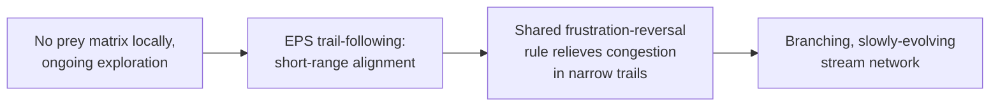
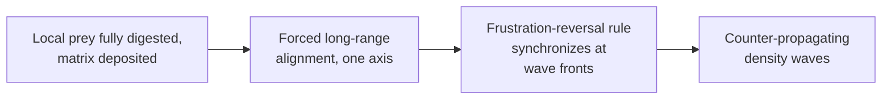

# Swarming & Rippling: Cause-to-Effect Pathways

*A restructured walkthrough of Saulnier et al. 2026 (*Nat. Phys.*, DOI: [10.1038/s41567-026-03416-y](https://doi.org/10.1038/s41567-026-03416-y)), organized by cause → effect rather than by literature-then-results. Companion to the [simulation plan](https://claude.ai/artifact/7oB77SQiP8dwqn6Q2pHDL4).*

## First, a correction worth having before the two pathways

Close, but one refinement matters: the paper's target isn't the simulations themselves — it's explaining the *single mechanism* that produces both patterns and their coexistence. Modeling (the 1D math and the 2D agent simulation) is the tool used to test that explanation, not the goal in itself. That's also why the introduction reads like a tour of other people's rippling-only or swarming-only models first: each earlier model only ever explained one pattern at a time, using a different rule set for each. The paper's actual contribution is showing that one rule set explains both.

The trigger → initiation → mechanism staging below is my organizing frame for clarity, not a structure the paper states explicitly — but it does track the paper's own logic: alignment (ECM-driven) sets the geometric stage, reversal (frustration-driven) is the engine that runs inside it.

## What's shared, before the two pathways split

Both patterns run on identical single-cell machinery — easy to miss if rippling and swarming are read as two separate stories. One circuit, one reversal rule, in both fields:

Frz receptor FrzCD → FrzE kinase phosphorylates FrzX and FrzZ → FrzX~P (lagging pole) and FrzZ~P (leading pole) shift which pole holds active MglA-GTP, via RomR and the GAP MglB → the cell reverses.

Both the refractory period and the post-refractory reversal rate are set by the same input in both fields — frustration, *f* — not density of any kind (tested and ruled out separately for each field; see below).

**f = 1 − (v_target · v_actual) / max(|v_target|², |v_actual|²)**

v_target is the velocity a cell "should" have with nothing in its way (its own body-axis direction at constant speed); v_actual is what it actually achieved that step. Only one thing differs between the two pathways below: which rule tells a cell which way to face. That's the entire split.

## Pathway 1 — Swarming

1. **Trigger.** Less a discrete switch-on than rippling's — swarming is the colony's default spreading behavior wherever there's no deposited prey matrix underfoot: prey-free ground outside the original colony's footprint, or any patch not yet fully digested.
2. **Initiation.** A-motility lets individual "scout" cells detach and explore ahead of the group. As a cell moves, type-IV pili bind and retract along self-deposited EPS ("slime trails"), and other cells' pili bind those same trails — this trail-following is what locks nearby cells into locally-moving flocks. Range matters: alignment measured this way (nematic order) drops off fast with distance, nothing like rippling's reach. It also doesn't need reversals to work at all — *frzE* cells, essentially reversal-incapable, still form coherent flocks outside the prey area, a direct experimental control.
3. **Mechanism.** The shared reversal rule above, operating inside narrow, branching, self-reinforced trails. Because cells are geometrically squeezed into those trails, congestion runs close to constant rather than concentrated at a few points — frustration there is broad and right-shifted (mean 0.68, low skew, wide spread) rather than sharply peaked. Reversals still concentrate somewhat in a cell's own high-frustration moments (43.6±2.1% fall in its own top quartile) but far less sharply than in rippling. No organized counter-flow exists to split this into two populations, so the time-between-reversals (TBR) distribution comes out unimodal (mean ≈3.73 min, n=5,904 in one representative experiment) — one broad population of congestion-triggered reversals, not two.
4. **What confirms it.** Neither local density nor directional density correlates with reversal here (local density even trends slightly negative) — ruling out density-based triggers for this field specifically. Residence time inside a swarming patch averages ≈67 min, shorter than rippling, because there's no periodic wave-collision to repeatedly trap a cell in place.

## Pathway 2 — Rippling

1. **Trigger.** A spatial, not temporal, condition: once a patch of prey is fully digested, the prey-derived matrix (cell-wall fragments) left behind is itself sufficient to induce rippling — shown directly by depositing cells onto purified prey cell-wall fragments with no live prey present at all. The trigger is the matrix's presence, not "currently eating."
2. **Initiation.** Cells on matrix-covered ground are pulled toward one shared direction (a nematic torque — head/tail doesn't matter), with no self-reinforcement the way EPS has. This produces long-range, persistent alignment that barely decays with distance — the quasi-1D geometry that makes organized, counter-propagating waves possible at all. Exactly like swarming, this doesn't need reversals either — the same *frzE* control shows cells still align normally on entering the prey area.
3. **Mechanism.** The *same* reversal rule as swarming, now operating on two aligned, opposing streams. Frustration spikes sharply and specifically where those streams meet (mean 0.48, but tightly peaked and negatively skewed — congestion concentrated at wavefront collisions, not spread out). Reversals cluster hard into a cell's own top frustration quartile (50.5±2.5%). The key extra ingredient the paper argues for: the refractory period itself — not just the reversal rate — shrinks as frustration rises. That's what lets a cell fire several reversals in quick succession exactly at a collision, producing the second, short-interval mode in rippling's *bimodal* TBR distribution (mean ≈3.21 min, n=5,283): one mode from rapid-fire collision reversals, one from cells riding a wave until the next oncoming one arrives, paced roughly to the wave period.
4. **Why shrinking RP specifically matters — the population-level math.** This is rippling's one piece of deeper theory that swarming doesn't get an equivalent of. A 1D continuum (PDE) model splits the population into right- and left-moving densities, u⁺(t,x,r) and u⁻(t,x,r), where r is time since a cell's last reversal. Two regimes are possible: *low-signalling*, where only the reversal rate responds to the signal and RP stays fixed; *high-signalling*, where RP itself shrinks with the signal instead. Reducing the system to two numbers — S = RP/T_REV (how pacemaker-like reversal timing is) and a coupling constant C (log-log sensitivity of timing to the signal) — a linear stability analysis around the uniform state shows traveling-wave patterns only emerge (the uniform state becomes unstable) in the high-signalling regime, and only once S is large enough. Low-signalling stays flat or grows too slowly to matter. This is the formal version of "RP has to be the tunable thing, not just the rate" — it's why shrinking RP is necessary, not just a nice-to-have detail.
5. **What confirms it, and one thing not to over-read.** Directional density (neighbors moving the opposite way) shows a weak correlation with reversal in rippling — but swapping it in as the actual *trigger*, replacing frustration, wrongly predicts the same correlation should appear in swarming too, which isn't observed; and only the frustration-driven version reproduces swarming's single-peaked TBR. So directional density is a by-product of the forced 1D geometry putting opposing cells shoulder-to-shoulder exactly where congestion peaks — not a second, independent trigger running alongside frustration. Residence time inside rippling ground averages ≈121 min, about 1.8× swarming's, because the zigzag, wave-colliding motion repeatedly traps a cell in place; reversal-incapable cells don't get this trapping and are gradually sorted out of rippling territory over time — raised as a possible selective step ahead of spore formation.

## Side by side

| | Swarming | Rippling |
|---|---|---|
| Local trigger | No prey matrix present | Prey matrix deposited after local digestion |
| Alignment rule | EPS trail-following (self-reinforcing) | Forced single axis (no self-reinforcement) |
| Alignment range | Short, decays fast with distance | Long, barely decays |
| Needs reversal to align? | No (*frzE* control) | No (*frzE* control) |
| TBR shape, mean | Unimodal, ≈3.73 min | Bimodal, ≈3.21 min |
| Frustration mean, shape | 0.68, broad / low-skew | 0.48, sharply peaked |
| Reversals in own top frustration quartile | 43.6±2.1% | 50.5±2.5% |
| Correlates with a density signal? | No (local density even slightly negative) | Weakly, with directional density only — shown to be a by-product |
| Residence time per visit | ≈67 min | ≈121 min |
| Visible pattern | Branching stream network | Counter-propagating waves |
